# HW - Kubernetes Monitoring and Centralized Logs


## 1. Verify Prometheus Targets

Prometheus was installed in the `monitoring-gf` namespace to collect metrics from the Kubernetes cluster.

The Targets section was used to verify that the monitoring targets were discovered and that their status was `UP`.

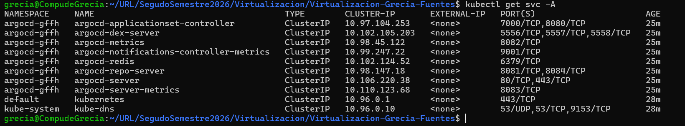

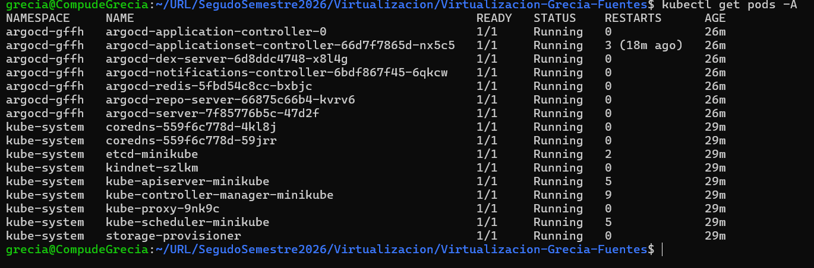

---

## 2. Access Prometheus

Prometheus was verified through its web interface to confirm that the service was accessible and ready to receive queries.

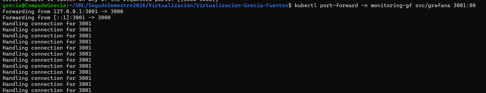

---

## 3. Configure Grafana Data Sources

Grafana was installed in the `monitoring-gf` namespace. Its data sources were configured through provisioning in the Helm values file.

The configured data sources are:

- **Prometheus:** `http://prometheus-server.monitoring-gf.svc.cluster.local`
- **Loki:** `http://loki.monitoring-gf.svc.cluster.local:3100`

Prometheus is the default data source for metrics, while Loki is used to query centralized container logs.

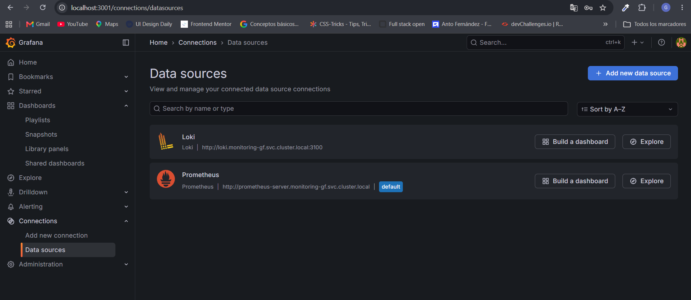

### 3.1. Verify Prometheus Data Source

The Prometheus connection was tested from Grafana.

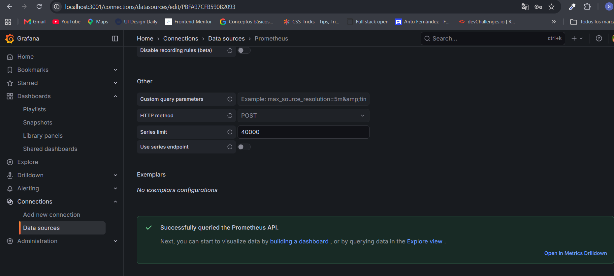

### 3.2. Verify Loki Data Source

The Loki connection was also tested from Grafana.

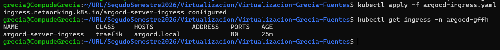

---

## 4. Kubernetes Metrics Dashboard

A dashboard named **Monitoreo Kubernetes - Grecia** was created in Grafana using a JSON dashboard definition.

The dashboard includes panels for Kubernetes pod status and CPU usage. The dashboard configuration is stored in the repository.

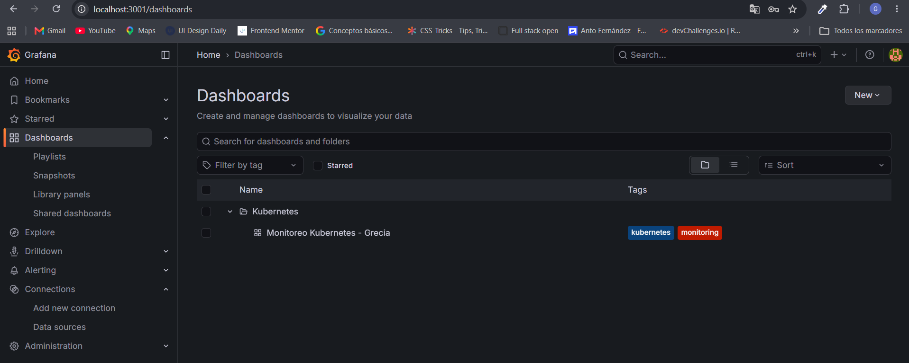

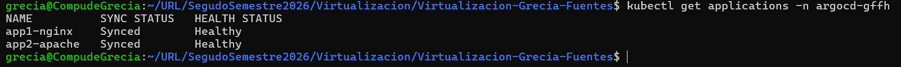

Dashboard file:

`grafana/dashboards/kubernetes-apps.json`

---

## 5. Centralized Logs with Loki and Promtail

Loki was installed to store and query container logs. Promtail runs as a DaemonSet and collects container logs from the Kubernetes nodes before sending them to Loki.

The Loki push endpoint is:

`http://loki.monitoring-gf.svc.cluster.local:3100/loki/api/v1/push`

Promtail collects logs from the application namespace `parcial-gffh` and from Traefik.

### 5.1. Query Logs from the Application Namespace

The following Loki query was used to view application logs:

```logql
{namespace="parcial-gffh"}
```

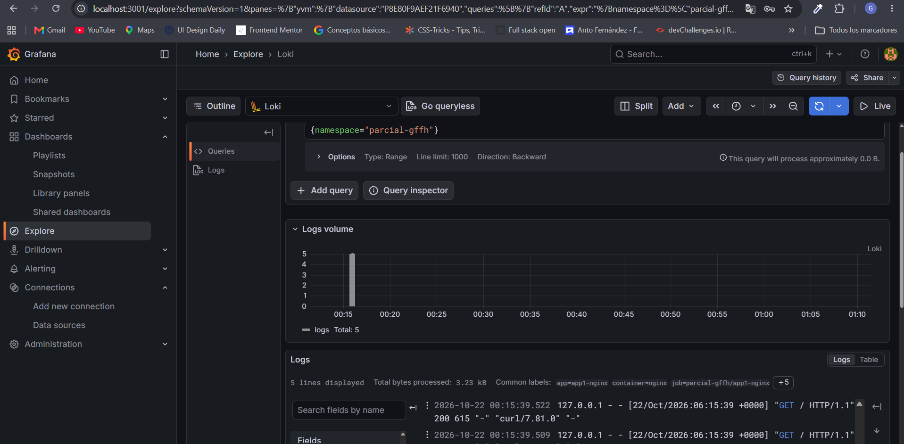

### 5.2. Query Traefik Logs

Traefik logs were queried separately to verify that its logs were also being collected.

```logql
{namespace="traefik"}
```

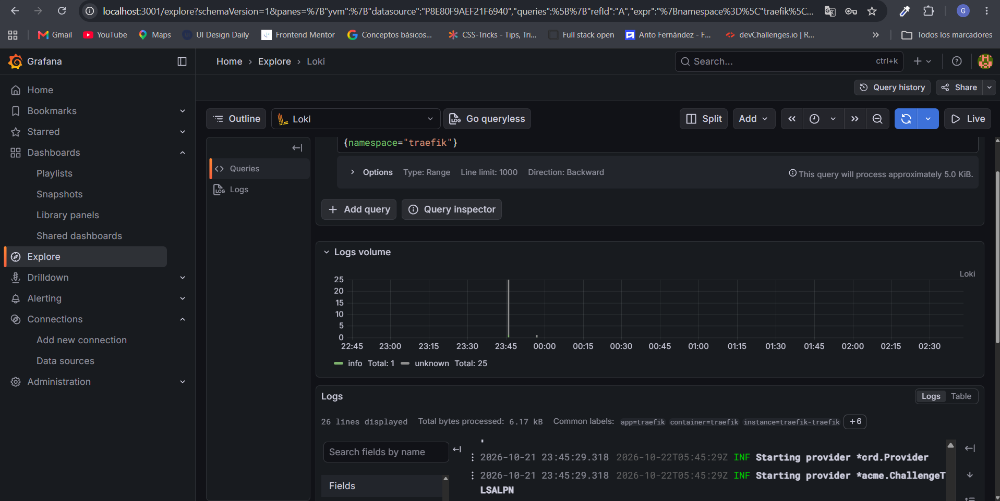

---

## 6. Deploy the Four Applications

Four applications were deployed in the `parcial-gffh` namespace:

- `app1-nginx`
- `app2-apache`
- `app3-httpd`
- `app4-caddy`

Their pods and deployments were checked to verify their status.

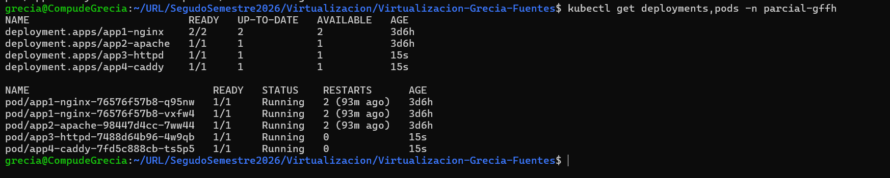

---

## 7. Verify Logs from the Four Applications

The logs of each application were queried from Loki using its namespace and pod labels.

### 7.1. NGINX Logs


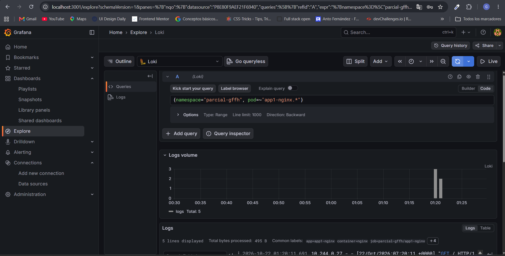

### 7.2. Apache Logs


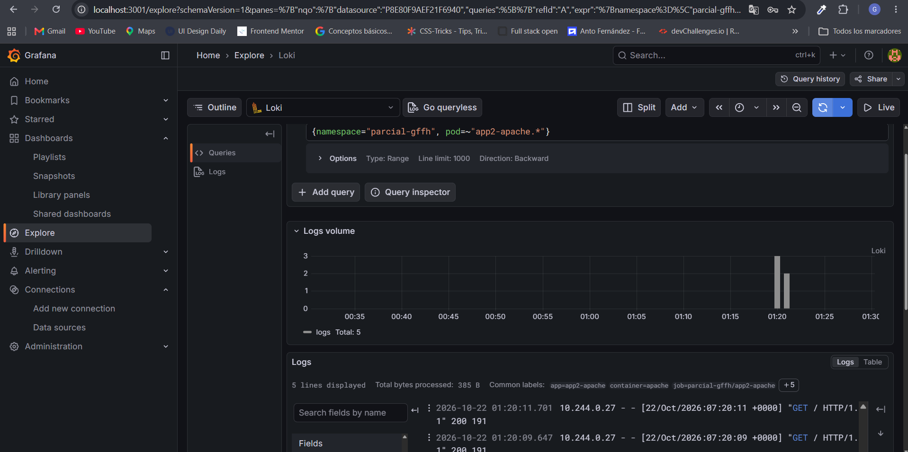

### 7.3. HTTPD Logs


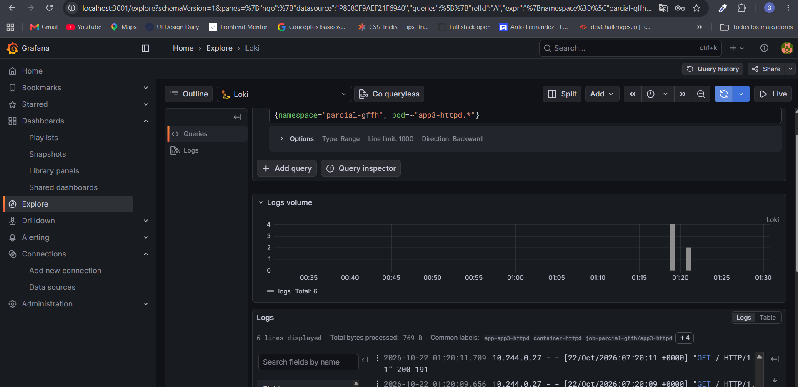

### 7.4. Caddy Logs


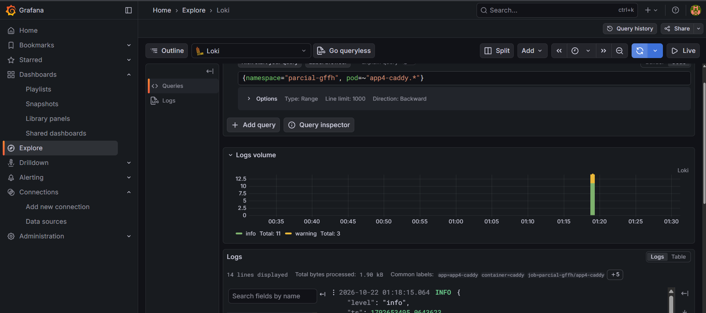

---

## 8. Grafana Logs Dashboard

A Grafana dashboard named **Logs de aplicaciones - Grecia** was created to display logs from all four applications using Loki.

The dashboard query is:

```logql
{namespace="parcial-gffh", pod=~"app1-nginx.*|app2-apache.*|app3-httpd.*|app4-caddy.*"}
```

Dashboard file:

`grafana/dashboards/logs-apps.json`

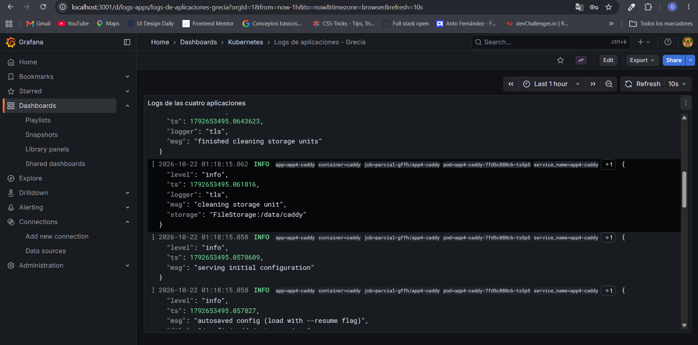

---

### 9 Access Grafana through Its Domain

Grafana was accessed using the `grafana.local` hostname through the Traefik entry point.

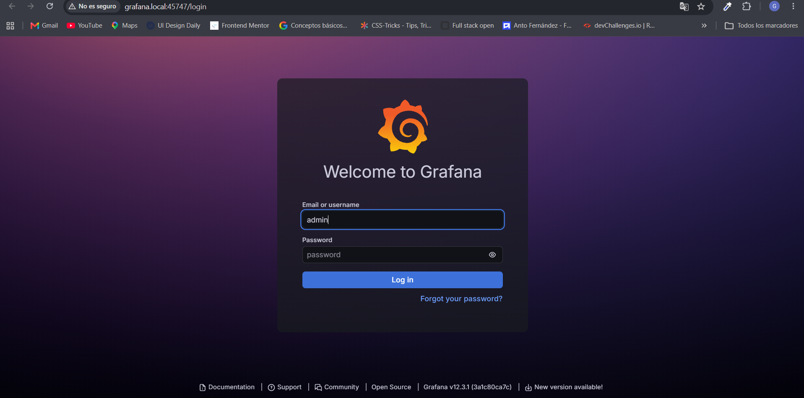

### 9 Access Prometheus through Its Domain

Prometheus was accessed using the `prometheus.local` hostname through the Traefik entry point.

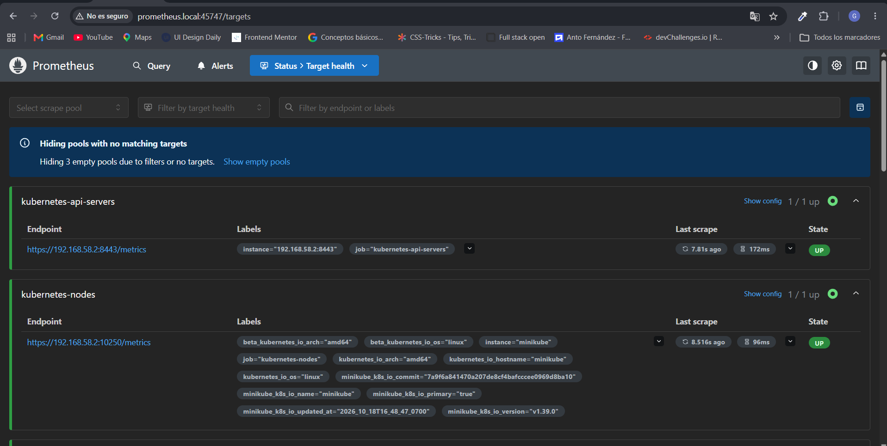


---
